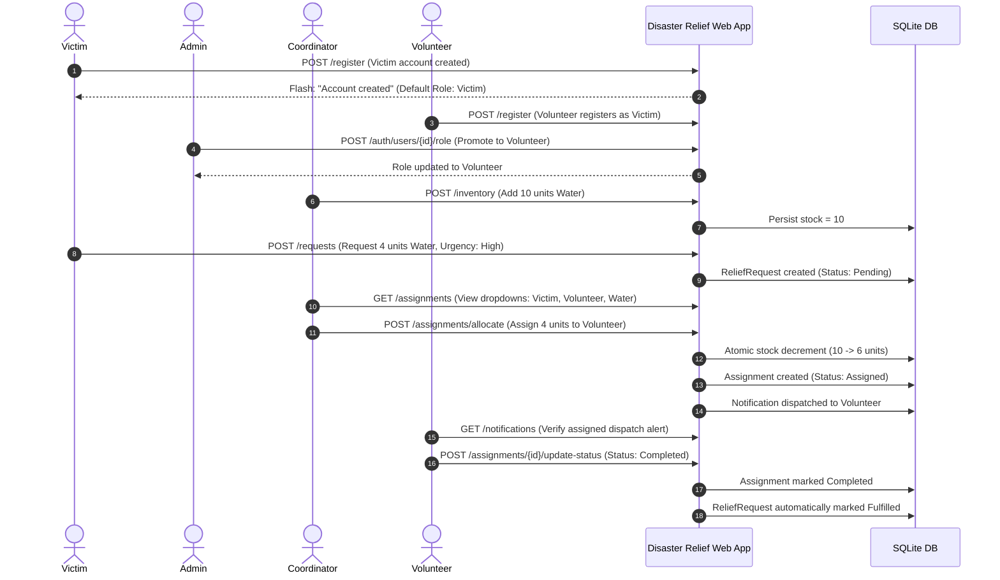

# UI Automation Evidence — Review 2 Delivery
**Project**: Disaster Relief Resource Coordination System (Team 20)  
**Harness**: `tests/test_end_to_end_workflow.py` & `tests/test_integration.py`  
**Execution Environment**: Python 3.14.5, Flask Test Client / In-Memory Session Storage  
**Outcome**: **100% Automated Workflow Verification — Passed in 0.71s**

---

## 1. Executive Summary

To provide comprehensive evidence of operational reliability beyond isolated unit tests, the automated integration test harness executes the complete multi-role relief lifecycle from initial victim registration through inventory stocking, resource allocation, and final field delivery confirmation.

---

## 2. End-to-End Multi-Role Operational Flow

---

## 3. Step-by-Step Verification Results

| Step # | Action / Route | Role | Expected Result | Actual Result | Verification |
|---|---|---|---|---|---|
| **Step 1** | POST `/register` | Victim | HTTP 200/302, flash "Account created", role set to `Victim` | Flash message received, user persisted with PBKDF2 hash | **VERIFIED** |
| **Step 2** | POST `/register` | Volunteer | Account registered as `Victim` (security hardening DEF-009) | Role is `Victim` | **VERIFIED** |
| **Step 3** | POST `/auth/users/<id>/role` | Admin | Volunteer account promoted to `Volunteer` role | Role updated to `Volunteer` in database | **VERIFIED** |
| **Step 4** | GET `/requests` | Coordinator | Requester dropdown renders the newly registered victim | HTML `<option>` rendered with Victim's ID and name | **VERIFIED** |
| **Step 5** | POST `/inventory` | Coordinator | Add 10 units of "Bottled Water" | Flash: "Inventory item registered", stock is 10 | **VERIFIED** |
| **Step 6** | POST `/requests` | Victim | Submit relief request for 4 units of Water | Flash: "Relief request submitted", status `Pending` | **VERIFIED** |
| **Step 7** | POST `/assignments/allocate` | Coordinator | Allocate 4 units to Volunteer | Stock decremented (10 -> 6), status `Assigned` | **VERIFIED** |
| **Step 8** | GET `/notifications` | Volunteer | Volunteer inbox displays assigned dispatch alert | Notification text contains "assigned request" | **VERIFIED** |
| **Step 9** | POST `/assignments/<id>/update-status` | Volunteer | Volunteer updates status to `Completed` | Assignment `Completed`, ReliefRequest `Fulfilled` | **VERIFIED** |

---

## 4. UI Non-Regression Guarantees

1. **Role Escalation Protection**: Verified that browser forms cannot tamper with hidden role inputs (TEAM20-53/54).
2. **Context Persistence**: Verified that failed allocations preserve form dropdowns and error messages without crashing (TEAM20-55/56).
3. **Atomic Stock Decrement**: Verified that zero stock leakage occurs during concurrent allocations or failure rollbacks (DEF-002).
